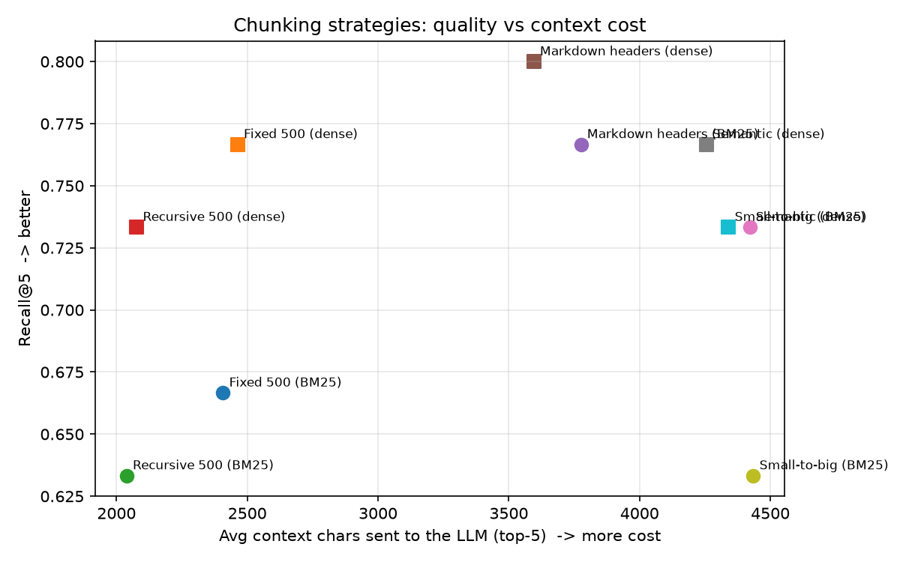

# 01 · The chunking lab

**Idea:** in the "open-book exam" picture of RAG, chunking is how you cut the textbook into pages. How you cut decides what you can find. This lab cuts the same FastAPI docs 5 ways and grades each with the Project 00 eval set.

## The 5 strategies (`src/ragkit/chunking.py`)

| # | Strategy | How it cuts | Built with |
|---|---|---|---|
| 1 | Fixed 500 | Every 500 characters, mid-sentence if needed | LangChain `CharacterTextSplitter` |
| 2 | Recursive 500 | Paragraph → line → sentence → word, 50-char overlap | LangChain `RecursiveCharacterTextSplitter` |
| 3 | Markdown headers | One chunk per section, with a heading "breadcrumb" in front | LangChain `MarkdownHeaderTextSplitter` |
| 4 | Semantic | Embeds every sentence and cuts where the topic shifts | Hand-written (LangChain equivalent: `SemanticChunker`) |
| 5 | Small-to-big | Searches 200-char children, returns their parent section | Hand-written (LangChain equivalent: `ParentDocumentRetriever`) |

Each strategy is searched two ways: **BM25** (keyword) and **dense embeddings** (`BAAI/bge-small-en-v1.5`, cosine similarity in NumPy).

## Run it

```bash
uv run python projects/01_chunking_lab/run_lab.py
```
The first run downloads the embedding model (~130 MB) and embeds everything (a few minutes). Re-runs use the cache in `.cache/`.
Output: `results/results.md` and `results/recall_vs_context.png`.

## Results (BGE-small run on a MacBook)

Recall@5 = share of the 30 questions whose answer appeared in the top 5 results.

| Strategy | Chunks | Avg chars | BM25 Recall@5 | BM25 MRR | Dense Recall@5 | Dense MRR | Context chars (dense) |
|---|---:|---:|---:|---:|---:|---:|---:|
| Fixed 500 | 1,301 | 477 | 0.67 | 0.50 | 0.77 | 0.48 | 2,463 |
| Recursive 500 | 1,570 | 402 | 0.63 | 0.45 | 0.73 | 0.57 | 2,077 |
| **Markdown headers** | 1,049 | 650 | **0.77** | 0.56 | **0.80** | 0.54 | 3,595 |
| Semantic | 1,084 | 566 | 0.73 | **0.59** | 0.77 | 0.51 | 4,255 |
| Small-to-big | 4,584 | 136 | 0.63 | 0.44 | 0.73 | 0.55 | 4,340 |

Full tables: [`results/results.md`](results/results.md)



## What to look for
- **Structure beats size:** markdown-header chunks give BM25 the best recall of the size-based strategies, because each chunk is one complete idea with its heading attached.
- **Quality vs cost:** bigger chunks hit more often but send more text to the LLM. Always read Recall@5 *together with* avg context chars. The chart plots exactly this.
- **Small-to-big** can lose to plain chunking on these short, focused questions. Its strength is giving the LLM full context once the right spot is found.
- **Keyword vs dense:** dense search won for most strategies, because the questions are worded differently from the docs. Neither reached 1.0, and they miss different questions, which is the case for hybrid search (Project 04).

## Check yourself
1. Why does cutting a sentence in half hurt retrieval?
2. Why does adding the heading breadcrumb help a chunk "stand on its own"?
3. In small-to-big, why do we de-duplicate results by parent?
4. What happens to semantic chunking if you change the percentile from 90 to 50? Predict, then try it.

## Break it (try these)
- Change `size=500` to `size=200` and `size=2000` in strategy 2. What happens to Recall and context size?
- Set `overlap=0` in strategy 2. Does anything change?

## Scale review
- **Scalability:** chunking 10M documents is a batch pipeline. Workers pull documents from a queue, chunk them, and write the chunks out. Ingestion runs separately from search, so search stays up while documents are re-processed.
- **Reliability:** one malformed file must not crash the whole run (log it to a "dead-letter" list and continue). Re-running must not create duplicate chunks (idempotency: derive chunk IDs from document ID + position).
- **Cost:** embedding is the slow, expensive step, which is why `embeddings.py` caches vectors by content hash. Unchanged text is never embedded twice.
- **Limits:** real systems also hit size caps (index limits per document) and must split oversized files *before* indexing.

## Learn more
Search for: "chunking strategies for RAG", "semantic chunking explained", "parent document retriever langchain", "what are embeddings", "cosine similarity explained". Read: LangChain text-splitter docs; Anthropic's "Contextual Retrieval" post.
